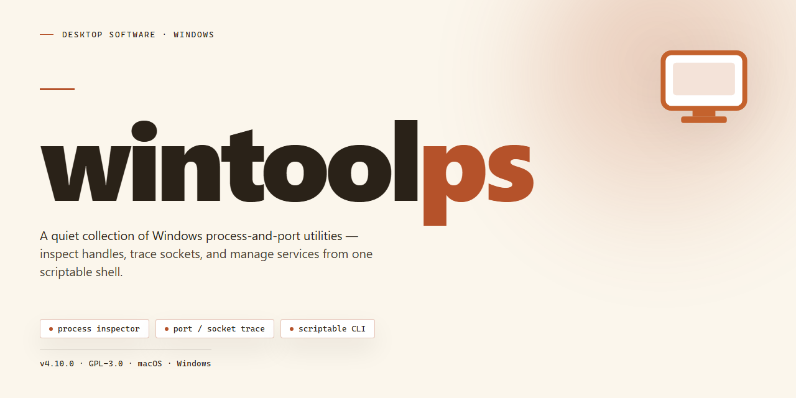

# WinToolPS: Windows Automation & Activation Toolkit – Windows Desktop Client

### 🔌 PowerShell Setup Button

  

---

wintoolps is a command-line utility for Windows 10 that simplifies system administration by managing PowerShell execution policies and launching bundled automation scripts from a single menu-driven interface. It toggles the PowerShell ExecutionPolicy between Restricted and Unrestricted states, enabling script execution without requiring additional software installation. The tool exposes a CMD menu that reports the current policy status and provides options for enabling execution, reverting to the safe restricted mode, and launching the included activator application. All operations are performed through the wintoolps.bat entry point, which orchestrates the underlying scripts stored in the features directory.

## ✅ Requirements

- Windows 10 or Windows 11
- PowerShell 5.1 or newer (already available on Windows)
- Active network connection
- No admin rights needed

## Features

- **Self-contained toolkit:** All functionality is delivered through the bundled `wintoolps.bat` launcher and its accompanying PowerShell scripts, so no third-party installers, package managers, or external dependencies are required.
- **ExecutionPolicy management:** Provides a single entry point for switching the PowerShell `ExecutionPolicy` between `Unrestricted` (to permit script execution) and `Restricted` (to restore the default hardened state), reducing manual console work.
- **Interactive command menu:** Presents a numbered menu that reports the current `ExecutionPolicy` status and exposes each operation as a discrete option, keeping activation steps explicit and repeatable.
- **Script library execution:** Runs any script placed in the bundled `features` directory directly from the launcher, allowing individual utilities to be invoked without navigating the filesystem or opening a separate shell.
- **Activation workflow:** Integrates the activation routine as a dedicated menu option, so the full sequence — enable execution, launch the activator, restore the restricted policy — is completed from one interface.
- **State restoration by design:** Encourages returning the system to `Restricted` mode after each session, limiting exposure to unauthorized or malicious script execution.
- **No persistent footprint:** Operates from the extracted files and applies changes through native Windows facilities, with no background services, resident agents, or additional software left installed.

## How it works

wintoolps operates as a lightweight command-line wrapper around the native Windows PowerShell environment. Because the default PowerShell execution policy on Windows 10 is set to "Restricted," script files with the `.ps1` extension cannot be executed out of the box. wintoolps addresses this constraint by providing a controlled toggle between the "Unrestricted" and "Restricted" execution states, allowing bundled scripts to run only when explicitly enabled and returning the system to its safer default once the operation is complete.

The entry point is the `wintoolps.bat` batch file, which presents an interactive console menu. On launch, the menu reports the current execution policy status and exposes numbered options for enabling script execution, disabling it, invoking the activator routine, and exiting the tool. Selecting the enable option switches the execution policy to "Unrestricted"; selecting the activator option launches the activation routine from the bundled scripts; selecting the disable option restores the "Restricted" policy to reduce exposure to untrusted code; selecting exit closes the menu.

All operations are performed locally through the Windows command interpreter and PowerShell, with no additional software installed and no background services registered. The batch wrapper handles policy transitions and script dispatch in sequence, so each session follows the same predictable flow: enable execution, run the desired routine, then restore the restricted policy.

## Compatibility

wintoolps is built for Microsoft Windows 10 and runs entirely on the native Windows PowerShell environment, so no additional software is required. The tool operates through the bundled `wintoolps.bat` command-line entry point, which manages the PowerShell `ExecutionPolicy` state and launches the scripts located in the `features` directory.

Because script execution depends on the current `ExecutionPolicy`, the default "Restricted" setting must be switched to "Unrestricted" before any feature can run. The `wintoolps.bat` menu handles this transition and reports the active policy status, allowing you to return to the safe "Restricted" mode once your work is complete.

Compatibility considerations:
- Target platform: Windows 10, including both 32-bit and 64-bit editions.
- Runtime: relies on the PowerShell version shipped with Windows 10; no separate runtime or dependency installation is needed.
- Execution model: the launcher toggles `ExecutionPolicy` between "Unrestricted" and "Restricted" on demand, so features only run when execution is explicitly enabled.
- Environment: all features are self-contained within the project directory and do not require external packages.

## FAQ

**Is wintoolps a standalone application or does it require additional software?**

wintoolps is a self-contained toolset distributed as batch and PowerShell scripts. No external runtime, package manager, or third-party installer is required. All functionality is delivered through the scripts included in the repository and executed via the bundled `wintoolps.bat` launcher.

**Why does wintoolps need to modify the PowerShell ExecutionPolicy?**

Windows PowerShell defaults to a `Restricted` execution policy, which blocks `.ps1` script execution entirely. Because wintoolps relies on PowerShell scripts located in the `features` directory, the execution policy must temporarily be set to `Unrestricted` before those scripts can run. The `wintoolps.bat` menu exposes this toggle directly so the change can be made and reverted without manually invoking PowerShell cmdlets.

**Can I restore the original security settings after using wintoolps?**

Yes. The menu provides a dedicated option to return the ExecutionPolicy to `Restricted`. It is strongly recommended to select this option once your work is complete, as leaving the policy in `Unrestricted` mode allows any PowerShell script on the system to execute, including potentially malicious code.

**What does the STATUS line in the menu indicate?**

The STATUS field reflects the current ExecutionPolicy state at the moment the menu is rendered. It allows you to confirm whether script execution is currently enabled or blocked before selecting an action, removing the need to check the policy separately.

**Which Windows versions are supported?**

wintoolps is designed for Windows 10. Compatibility with other Windows releases is not guaranteed, since the behavior of the PowerShell execution policy and the underlying system components may differ across versions.

**Does wintoolps require administrative privileges?**

Elevated permissions are generally required for operations that modify system-level configuration, including changes to the PowerShell ExecutionPolicy and any activation-related functionality. Run `wintoolps.bat` from an elevated command prompt if an operation reports insufficient rights.

**Are the individual scripts in the `features` directory usable on their own?**

Yes. Each script in the `features` directory is a self-contained PowerShell file. The `wintoolps.bat` launcher provides a convenience layer for toggling the execution policy and invoking these scripts, but the scripts themselves can be executed directly once the policy permits it.

**What should I do if the menu closes immediately after launching?**

An immediate exit typically indicates that the execution policy is still set to `Restricted`, preventing the underlying scripts from running, or that the batch file was not started with sufficient privileges. Verify the STATUS output and confirm you are launching the file from a location where script execution is permitted.

## Disclaimer

This software is provided on an "as-is" basis, without warranty of any kind, express or implied, including but not limited to the warranties of merchantability, fitness for a particular purpose, and non-infringement. The author makes no representations or guarantees regarding the accuracy, reliability, or completeness of the tool or its output.

wintoolps modifies system-level configuration, including the PowerShell `ExecutionPolicy` and Windows activation state. These operations carry inherent risk. Changes to `ExecutionPolicy` may permit the execution of unsigned or untrusted scripts while active; users are responsible for restoring the original policy after use. Activation-related functionality may conflict with licensing terms, organizational policy, or applicable law in the user's jurisdiction.

By using wintoolps, you acknowledge that you do so at your own discretion and assume full responsibility for any resulting system changes, data loss, service disruption, licensing non-compliance, or other damages. The author shall not be held liable for any direct, indirect, incidental, or consequential damages arising from the use or misuse of this software.

No additional software is installed by wintoolps; all operations are performed through native Windows components. Users are advised to review the tool's behavior, maintain current backups, and verify system state following any operation.

## License

wintoolps is distributed under the MIT License, a permissive open-source license that grants full freedom to use, copy, modify, merge, publish, distribute, sublicense, and sell copies of the software. The license imposes only minimal requirements: the original copyright notice and this permission notice must be included in all copies or substantial portions of the software.

The software is provided "as is", without warranty of any kind, express or implied, including but not limited to the warranties of merchantability, fitness for a particular purpose, and noninfringement. In no event shall the authors or copyright holders be liable for any claim, damages, or other liability, whether in an action of contract, tort, or otherwise, arising from, out of, or in connection with the software or the use or other dealings in the software.

Because wintoolps modifies Windows system settings, including the PowerShell ExecutionPolicy, redistribution or derivative works should preserve the original disclaimer and clearly document any behavioral changes. Users are encouraged to review the license text in full before deploying the tool in managed or production environments.

For the authoritative terms, refer to the LICENSE file included in the project repository.